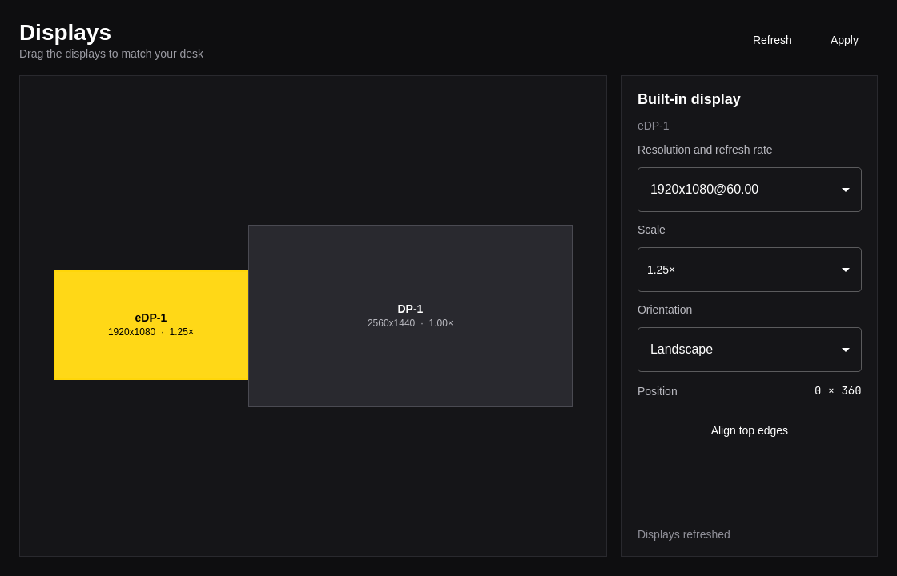

# Omonitor

Omonitor is a small, keyboard-friendly display arranger for Omarchy and Hyprland.
It follows the active Omarchy accent, language, and window rounding.



## Features

- Drag displays into their physical arrangement.
- Pick resolution, refresh rate, scale, and orientation.
- Preserve manual settings outside Omonitor's managed block in `monitors.lua`.
- Validate the new Hyprland configuration before accepting it.
- Automatically restore the previous configuration after 15 seconds unless confirmed.
- Follow Omarchy's theme and language live (English and Italian included).

## Build

```sh
./bin/build
./bin/test
```

## Install on Omarchy

```sh
./bin/install
```

The package installs the `omonitor` binary and its launcher entry. Open it with
`Super + Space`, then search for **Omonitor**.

## Keyboard shortcuts

| Key | Action |
| --- | --- |
| `Space` | Apply the display configuration |
| `R` | Refresh displays |
| `?` | Show or hide shortcut help |
| `Q` | Quit |

## Configuration safety

Omonitor writes only the block delimited by `-- omonitor:start` and
`-- omonitor:end` in `~/.config/hypr/monitors.lua`. Before each write it creates
a timestamped `.bak` copy. If `hyprctl reload` or `hyprctl configerrors` fails,
the previous file is restored immediately.

## License

MIT
